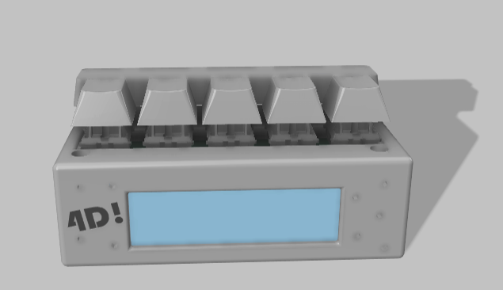
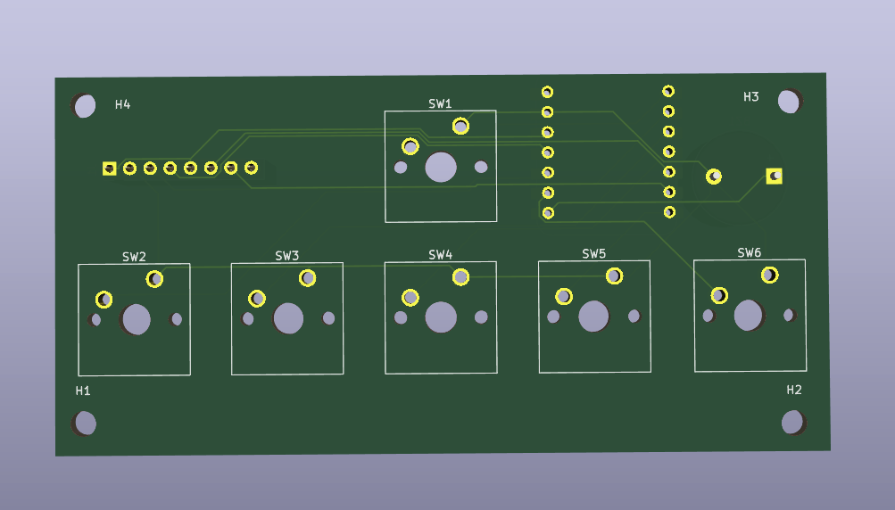
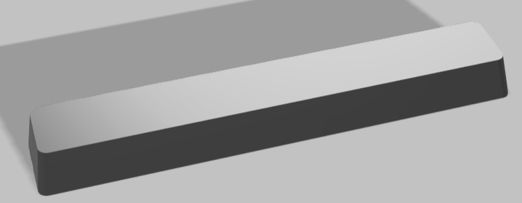
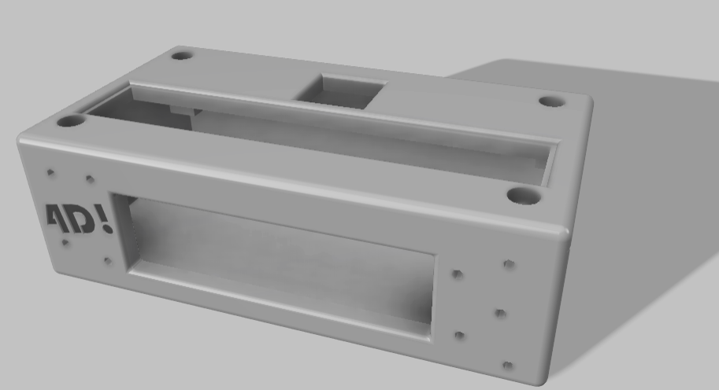
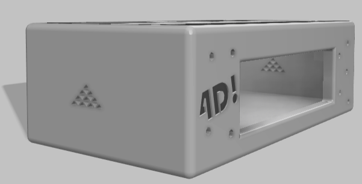
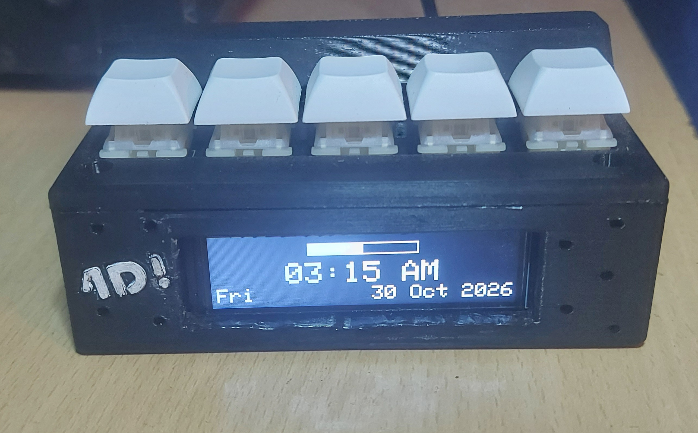

# 4th-Dimension-Tracker
The all in one clock that has alarm, stopwatch and timer functionality which also looks really cool on the desk.

  

# PCB
The PCB is designed on Kicad for the following components -  
 - 6 mx style switches 
 - seeduino board 
 - buzzer 
 - TFT display.

It will be mounted with the lid of the case using 4 screws and heatset inserts.

### Schematic

  

### Design

  

### Preview

  

# CAD
 - For this project there are 2 things to be 3D printed, a case and a large keycap (Slightly smaller than a usual spacebar on our keyboard)

  

 - The case has hexagonal designs on the front and a text "4D!" which can be printed in a different colour and then stuck into the case. 

  

 - It consists of two parts, the lid and the base, assembled via 4 screws which also support the pcb.

 - On the sides we have triangular holes on the sides for sound to come out.

  

 - There are pillar like blocks inside the case to install the heatset screws.

# Firmware & Interface
The clock has a cool interface that let's you access the following menus - 

 - Home - Shows time, day and date along with a volume bar. Increase or decrease the volume with 2nd and 3rd button.
 - Stopwatch - Start or stop the stopwatch with the action button, reset with 2nd button.(sometimes won't work u may have to press multiple times)
 - Timer - Lets you set the time with 2nd,4th and 5th button. Use action button to start or dimiss timer and 3rd button to reset.(sometimes won't work u may have to press multiple times)
 - Alarm - Lets you set the specific days and time for alarm using 2nd, 3rd and 4th button. Dismiss with action button.

**It must be connected to wifi so that it could fetch time accurately. Therefore don't forget to add your wifi creds in the code before uploading it to the esp32 c3.**

# Build
**4D tracker has been built!**
<a href="https://youtu.be/zwGX6XkCOzQ">Check out the demo video!</a>

  

There were a few flaws in the CAD like the usb port was not aligned and ther space was pretty less inside for jumper cables. All these imrovements have however been made in the CAD.

I really enjoyed making this project and it is something that solves an actual problem in my life bcz I never wake up on time. 

# BOM
From the Blare kit - 
 - 1x Seeed XIAO ESP32C3
 - 6x MX-Style Keyboard Switches
 - 6x White Blank DSA Keycaps
 - 1x 2.25in TFT Screen
 - 1x 3.3V Piezo Buzzer
 - 1x 2.54mm 8 Pin Male Header
 - 8x 20cm Female-Female Jumper Wires
 - 4x M3x5x4 Heatset Inserts
 - 4x M3x8mm Screws

From the grant - 
 - 3D printed case
 - 3D printed keycap
 - PCB

# AI Usage
I mostly used google ai to help me with the firmware. The ringtone that plays when the alarm rings is also generated by AI. Sometimes to help me with basic things like navigating around in kicad or fusion and searching up things when I got stuck.